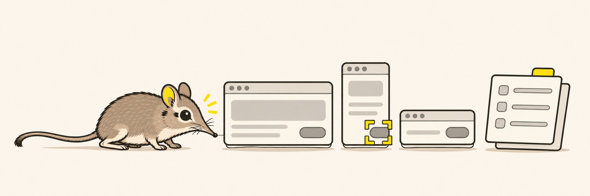

# 검증맨



검증맨은 화면 하나를 여러 크기로 열어 잘림과 겹침을 확인하는 에이전트 스킬입니다. 실제 화면 크기와 스크린샷을 저장하고, 발견한 문제는 이미지에 노란 박스로 표시합니다.

```bash
npx skills add tumblecat44/geomjeungman
```

자동 캡처에는 Python 3와 `agent-browser`가 필요합니다. `agent-browser`를 처음 쓴다면 CLI를 설치한 뒤 `agent-browser install`로 브라우저를 준비하세요.

> 검증맨, `http://localhost:3000/pricing`에서 가격표가 작은 화면에서도 잘리지 않는지 확인해줘.

검사가 끝나면 `.geomjeung/index.html`이 열립니다. 왼쪽에서 날짜와 검사를 고르고, 캔버스에서 스크린샷을 옮기거나 확대해 비교할 수 있습니다. 자세한 검사 순서는 [스킬 안내서](skills/geomjeungman/SKILL.md)에 있습니다.
