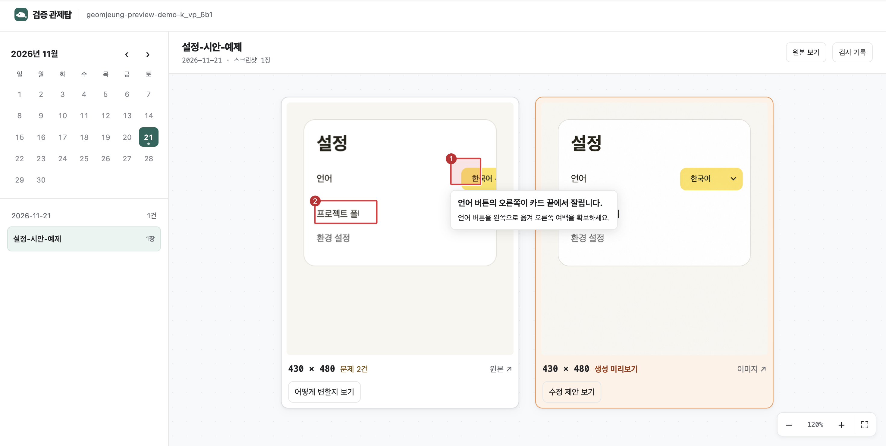

# 검증맨


검증맨은 화면 하나를 여러 크기로 열어 잘림과 겹침을 확인하는 에이전트 스킬입니다. 실제 화면 크기와 스크린샷을 저장합니다.

```bash
npx skills add tumblecat44/geomjeungman
```

자동 캡처는 Python 3와 Agent Browser로 실행합니다. Agent Browser가 크기를 바꾸고 실측값과 PNG를 저장합니다. Agent Browser가 없으면 스크립트가 npm으로 설치합니다. Chrome DevTools MCP는 성능, 콘솔 오류, 네트워크 로그를 확인하는 데 씁니다.

> 검증맨, `http://localhost:3000/pricing`에서 가격표가 작은 화면에서도 잘리지 않는지 확인해줘.

## 검증 관제탑

검사가 끝나면 `.geomjeung/index.html`이 열립니다. 왼쪽에서 날짜와 검사를 고르고, 캔버스에서 스크린샷을 옮기거나 확대해 비교할 수 있습니다.

`geomjeungman-dashboard` 스킬을 `geomjeungman`과 함께 설치하면 로컬 웹 서버를 켜고 끌 수 있습니다. 검사 대상 프로젝트에서 “검증 관제탑 켜줘” 또는 “검증 관제탑 꺼줘”라고 요청하세요. [관제탑 스킬 안내서](skills/geomjeungman-dashboard/SKILL.md)



빨간 박스에 마우스를 올리면 해당 위치의 문제와 수정 제안이 보입니다. **어떻게 변할지 보기**에서 **이미지 생성**을 누르면 수정 제안을 반영한 시안이 원본 옆에 주황색 카드로 나타납니다.

자세한 검사 순서와 이미지 생성 방법은 [스킬 안내서](skills/geomjeungman/SKILL.md)에 있습니다.
